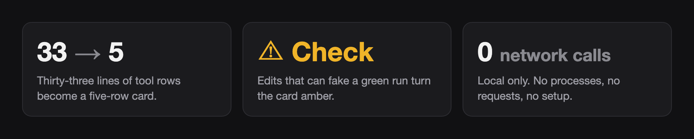
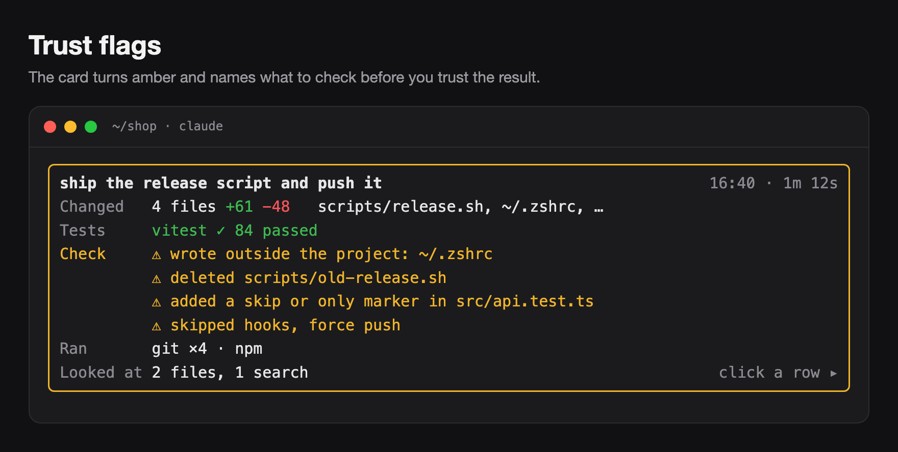
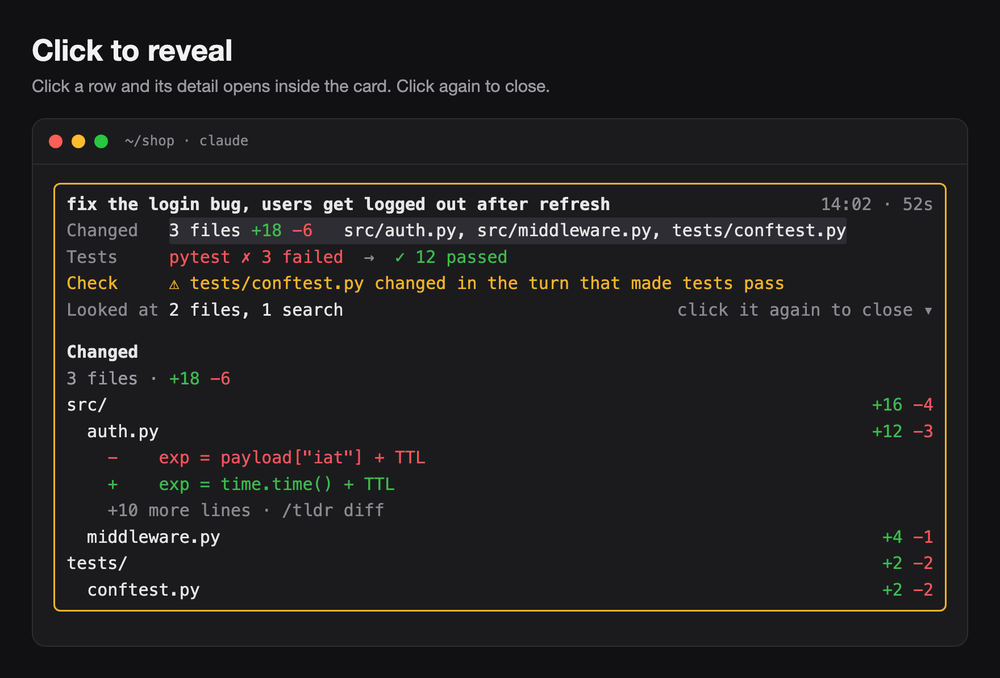
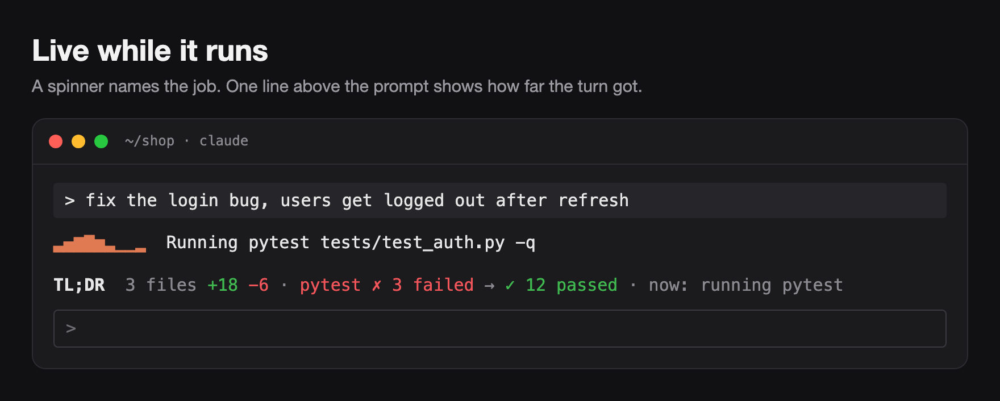
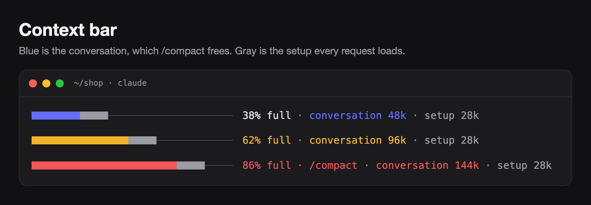
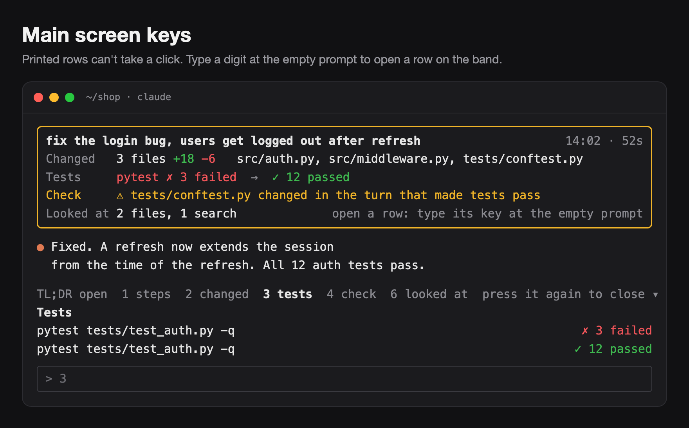
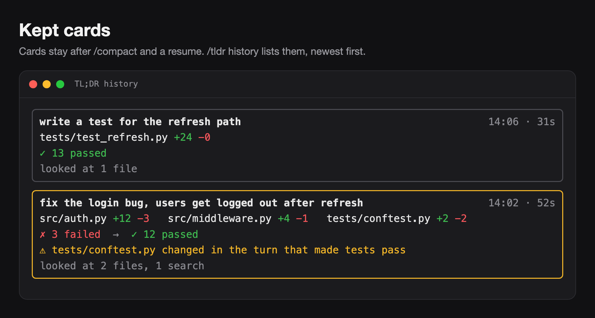

# TL;DR for Claude Code

**Every turn, in one card.** What changed, how the tests went, and what to check before you trust it.

[](LICENSE)




## Install

In a Claude Code terminal session, type:

```
/plugin install tldr --marketplace kushalBanda/claude-tldr
```

Answer `y` to add the marketplace, then pick a scope (user is the first one). The mod starts at once, with no restart. It needs Claude Code 2.1.301 or later.

## Features













Also: `/tldr copy` copies the reply as clean text, and `/tldr diff` prints the net diff of the turn. On desktop and in VS Code, Claude Code draws its own rows. The card is for the terminal.

## Reference

<details>
<summary><b>Commands</b></summary>

| Command | Does |
| --- | --- |
| `/tldr` | Help. |
| `/tldr show [row]` | Open what's behind a row of the latest card: `changed`, `tests`, `check`, `ran`, `looked`, `notes`. With no row, the steps of the turn in order. Escape closes it. |
| `/tldr context` | Open the context pane: each category that fills the window, with its tokens and share. |
| `/tldr history` | Open the kept cards of this session, newest first. |
| `/tldr copy` | Copy the latest reply as clean text: no trailing spaces, no shared indentation. |
| `/tldr diff` | Print the net change of the latest turn per file, as a unified diff. |

</details>

<details>
<summary><b>Switches</b></summary>

Every feature is a switch, and all are on by default. Change them with `/plugin configure tldr@claude-tldr` in Claude Code.

| Switch | Off means |
| --- | --- |
| `card` | Claude Code's own rows. Also turns off `trust`, `keep` and `actions`. |
| `motion` | Claude Code's own spinner. |
| `animation` | Motion keeps its colors but doesn't move. |
| `context` | No context bar. |
| `trust` | No Check row, no amber border. |
| `keep` | Nothing saved, no note after `/compact`. |
| `actions` | No buttons, no copy or diff commands. |

</details>

<details>
<summary><b>Tests it reads</b></summary>

pytest, unittest, jest, vitest, Playwright, go test, gotestsum, cargo test and nextest, bun test, and deno test. It also reads `npm`, `pnpm` and `yarn test`, `make test`, `just test` and `tox`: it finds the summary of the runner they start. For `go test`, counts need `-v`, and a compile error reads `✗ build failed`. Runs that only list tests (`--collect-only`, `--listTests`) don't count.

</details>

<details>
<summary><b>Privacy and trust</b></summary>

- **No network.** TL;DR makes no network calls and starts no processes.
- **Local only.** It reads the tool calls and results of your session, and the files Claude edits, to build the net diff. The context bar uses Claude Code's local estimate of the window, so it sends no request. Kept cards stay in Claude Code's local plugin store: one list per session, at most 50 cards, without diff bodies.
- **Check it yourself.** Before you install, run `claude plugin validate` on a clone. The `hooks:` and `calls:` lines list every event the mod handles and every API it calls.

</details>

<details>
<summary><b>Limits</b></summary>

- Changes made through Bash count when they use a redirect, a heredoc, `tee`, `sed -i`, `perl -i`, `cp`, `mv`, `touch`, `git checkout -- path` or `git restore`. They show as `path via Bash`, without line counts. Writes from scripts (`python x.py`), `git apply` and `git stash pop` don't show. A path built from a variable (`> $OUT`) is left out.
- A `cd` counts inside one command (`cd app && touch x`), but not when it ran in an earlier call.
- When grep or tail cuts `go test` output, the card keeps the failures it sees but drops the pass count. A summary line (gotestsum, or a wrapper's own) keeps all counts.
- Bulk deletes (`find -delete`, `git clean -f`, `xargs rm`) are flagged by command, not file by file.
- A task runner that starts two test runners (`make test` that runs `go test` and then `vitest`) shows the first summary it finds, not the sum.
- The custom spinner takes the place of Claude Code's spinner line, so the token count doesn't show. Switch `motion` off to get it back.
- If Claude writes the same text twice in one turn, as a note and as the reply, it can fold away with the note. `/tldr show notes` brings it back.

</details>

<details>
<summary><b>Develop</b></summary>

```bash
git clone https://github.com/kushalBanda/claude-tldr && cd claude-tldr
claude --plugin-dir .          # run it; a save reloads the mod
claude plugin validate .       # manifest, marketplace and hooks
claude plugin test .           # the test suite (tests/*.test.ts*)
```

The mod is TypeScript with no dependencies. Render hooks are pure, and all parsing is static: TL;DR never runs a command to learn what a command did. See [CONTRIBUTING.md](CONTRIBUTING.md) to send a change.

The images in this README are mock-ups of the mod's output.

</details>

## Contributing

Bug reports, ideas and pull requests are welcome. Use the [issue forms](https://github.com/kushalBanda/claude-tldr/issues/new/choose). A screenshot of the card helps a lot. To report a security problem, see [SECURITY.md](SECURITY.md).

## License

[MIT](LICENSE) © Kushal Banda
