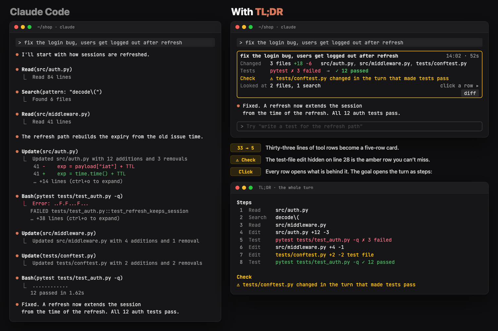

# TL;DR for Claude Code

**Every turn, in one card.** It shows the files Claude changed, the tests before and after, what Claude looked at, and what to check before you trust the result.

[](LICENSE)




One fix in Claude Code can print a hundred lines of reads, searches, diffs and test logs. To find out what changed and if it worked, you scroll. **TL;DR** folds the turn into one card. Every raw line stays one click away.

Look at the image above. Claude edited `tests/conftest.py` in the same turn that made the tests pass. In the plain transcript, that edit is line 28 of 33. On the card, it is the amber **Check** row.

## Install

In a Claude Code terminal session, type:

```
/plugin install tldr --marketplace kushalBanda/claude-tldr
```

Answer `y` to add the marketplace, then pick a scope (user is the first one). The mod starts at once, with no restart. It needs Claude Code 2.1.301 or later.

## What you get

- **Turn card:** one card per turn in place of the tool rows. It shows the goal, the time, the size of the turn (`3 files +18 −6`) and its files, the test runs in order, the other commands in one Ran row (`git ×3 · gh`), and what Claude read and searched. The text Claude writes between tool calls folds into the card. The final reply stays.
- **Trust flags:** the card turns amber and says what to check: a test file changed in the turn that made tests pass, a write outside the project, a deleted file, an added skip, only or xfail marker, `--no-verify`, or a force push.
- **Click to reveal:** click a row and a pane shows what is behind it. Click the goal and the pane shows the turn as steps.
- **Context bar:** one line above the prompt shows how full the context window is, in two colors: blue for the conversation, which `/compact` frees, and gray for the setup (system prompt, tools, memory, skills), which every request loads. The label names each color: `62% full · conversation 94k · setup 30k`. The percent turns amber at 75% and red at 90%, and then it points to `/compact`. You decide when to compact. Click the label (fullscreen) or run `/tldr context` for the setup rows and what each part means.
- **Motion:** a spinner that shows the mode (thinking, running tools, writing) and the current job (`Reading src/auth.py`). It also moves during `/compact`. While a turn runs, a TL;DR line above the prompt shows how far it got: `TL;DR  14 calls · 3 files +40 −6 · pytest ✗ 3 failed → ✓ 12 passed · now: running pytest`. It redraws only when a call starts or ends, and it goes away when the card takes over.
- **Kept cards:** each finished card is saved for the session. After `/compact` or a resume, `/tldr history` shows the earlier turns.
- **Actions:** copy the reply as clean text, or see the net diff of the turn.

### See how the tests went green

Click the goal line. The pane lists every step in order, so you see the test file edit between the red run and the green run. The lower window in the image above shows it.

### Both layouts

- **Fullscreen:** the card takes the place of the tool rows and updates live. Click a row (Changed, Tests, Check, Ran, Looked at) to open its pane. Changed groups files by folder and shows the first diff lines. Escape closes the pane.
- **Main screen (scrollback):** printed rows can't change. So each tool group becomes one summary line, and the full card prints where Claude Code's closing line ("Baked for 52s") was. Printed rows can't take a click, so the band above the prompt holds the rows of the latest card as keys: `TL;DR  1 steps  2 changed  3 tests  4 check  5 ran  6 looked at`. Type the digit into the empty prompt and pause, and the same pane opens. `/tldr show` works too.

On desktop and in VS Code, Claude Code draws its own rows. The card is for the terminal.

## Commands

| Command | Does |
| --- | --- |
| `/tldr` | Help. |
| `/tldr show [row]` | Open what's behind a row of the latest card: `changed`, `tests`, `check`, `ran`, `looked`, `notes`. With no row, the steps of the turn in order. Escape closes it. |
| `/tldr context` | Open the context pane: each category that fills the window, with its tokens and share. |
| `/tldr history` | Open the kept cards of this session, newest first. |
| `/tldr copy` | Copy the latest reply as clean text: no trailing spaces, no shared indentation. |
| `/tldr diff` | Print the net change of the latest turn per file, as a unified diff. |

## Switches

Every feature is a switch, and all are on by default. Change them with `/plugin configure tldr@claude-tldr` in Claude Code.

| Switch | Off means |
| --- | --- |
| `card` | Claude Code's own rows. Also turns off `trust`, `keep` and `actions`. |
| `motion` | Claude Code's own spinner. |
| `animation` | Motion keeps its colors but doesn't move. |
| `context` | No context bar. |
| `trust` | No Check row, no amber border. |
| `keep` | Nothing saved, no note after `/compact`. |
| `actions` | No buttons, no copy or diff commands. |

## Tests it reads

pytest, unittest, jest, vitest, Playwright, go test, gotestsum, cargo test and nextest, bun test, and deno test. It also reads `npm`, `pnpm` and `yarn test`, `make test`, `just test` and `tox`: it finds the summary of the runner they start. For `go test`, counts need `-v`, and a compile error reads `✗ build failed`. Runs that only list tests (`--collect-only`, `--listTests`) don't count.

## Privacy and trust

- **No network.** TL;DR makes no network calls and starts no processes.
- **Local only.** It reads the tool calls and results of your session, and the files Claude edits, to build the net diff. The context bar uses Claude Code's local estimate of the window, so it sends no request. Kept cards stay in Claude Code's local plugin store: one list per session, at most 50 cards, without diff bodies.
- **Check it yourself.** Before you install, run `claude plugin validate` on a clone. The `hooks:` and `calls:` lines list every event the mod handles and every API it calls.

## Limits

- Changes made through Bash count when they use a redirect, a heredoc, `tee`, `sed -i`, `perl -i`, `cp`, `mv`, `touch`, `git checkout -- path` or `git restore`. They show as `path via Bash`, without line counts. Writes from scripts (`python x.py`), `git apply` and `git stash pop` don't show. A path built from a variable (`> $OUT`) is left out.
- A `cd` counts inside one command (`cd app && touch x`), but not when it ran in an earlier call.
- When grep or tail cuts `go test` output, the card keeps the failures it sees but drops the pass count. A summary line (gotestsum, or a wrapper's own) keeps all counts.
- Bulk deletes (`find -delete`, `git clean -f`, `xargs rm`) are flagged by command, not file by file.
- A task runner that starts two test runners (`make test` that runs `go test` and then `vitest`) shows the first summary it finds, not the sum.
- The custom spinner takes the place of Claude Code's spinner line, so the token count doesn't show. Switch `motion` off to get it back.
- If Claude writes the same text twice in one turn, as a note and as the reply, it can fold away with the note. `/tldr show notes` brings it back.

## Develop

```bash
git clone https://github.com/kushalBanda/claude-tldr && cd claude-tldr
claude --plugin-dir .          # run it; a save reloads the mod
claude plugin validate .       # manifest, marketplace and hooks
claude plugin test .           # the test suite (tests/*.test.ts*)
```

The mod is TypeScript with no dependencies. Render hooks are pure, and all parsing is static: TL;DR never runs a command to learn what a command did. See [CONTRIBUTING.md](CONTRIBUTING.md) to send a change.

The cards in this README are the mod's real output for the test fixture in `tests/fixtures/login-bug.ts`, drawn by the test kit. The plain Claude Code panel beside it is a mock-up of the same turn.

## Contributing

Bug reports, ideas and pull requests are welcome. Use the [issue forms](https://github.com/kushalBanda/claude-tldr/issues/new/choose). A screenshot of the card helps a lot. To report a security problem, see [SECURITY.md](SECURITY.md).

## License

[MIT](LICENSE) © Kushal Banda
